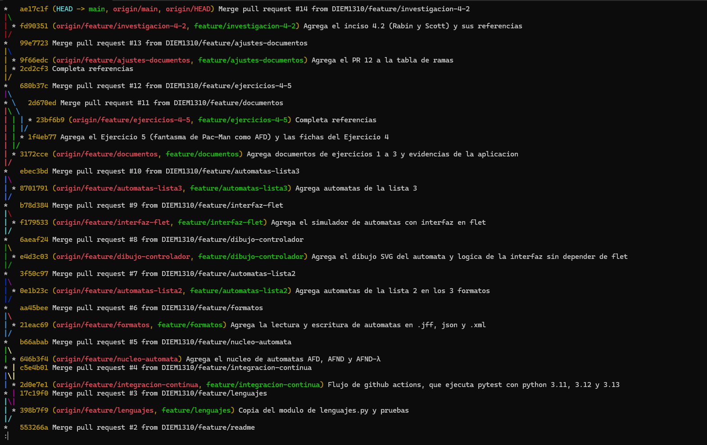
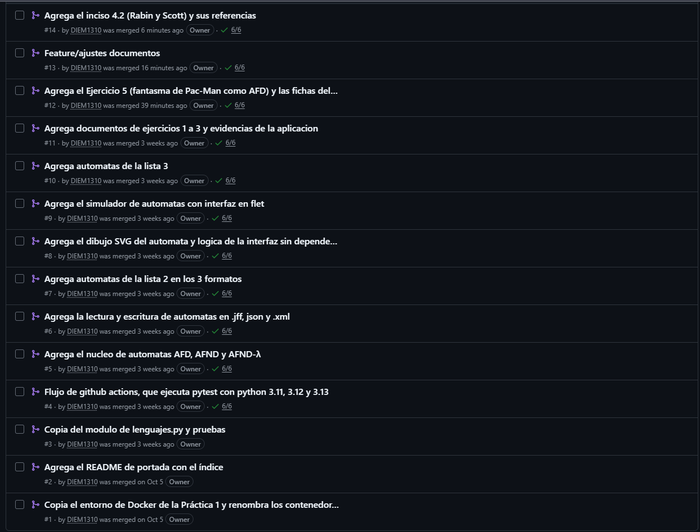
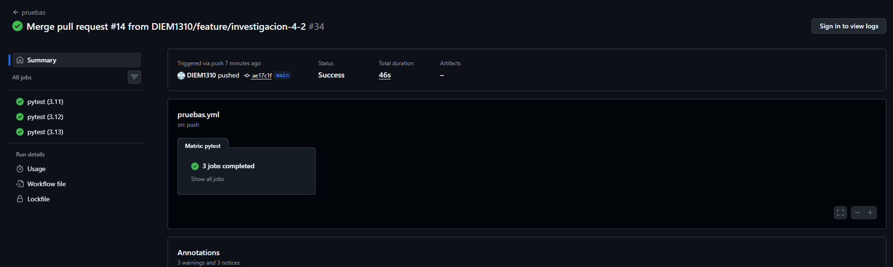

# Ejercicio 1. Entorno de trabajo y flujo de ramas

El entorno de la Práctica 1 se reutiliza sin reescribirlo; lo que cambia en esta práctica es la forma de trabajar sobre el repositorio: una rama por funcionalidad, un Pull Request por cada cambio y una integración continua que ejecuta las pruebas con tres versiones de Python.

## 1.1. Qué se copió de la Práctica 1 y qué cambió

Repositorio de la Práctica 1: <https://github.com/DIEM1310/Teoria_Computacion_4CV4_Practica_1>

| Archivo | ¿Cambió? | Detalle |
|---|---|---|
| `entorno/Dockerfile` | No | Idéntico. Una sola receta para las tres versiones; el número llega como argumento de construcción. |
| `entorno/compose.yml` | Sí | Solo el nombre de los contenedores: `tc_p1_*` pasa a `tc_p2_*`. |
| `requirements.txt` | No | Dependencias con versión fijada (entre ellas `flet==0.86.5` y `pytest==8.3.4`). |
| `pytest.ini` | No | `pythonpath = src` y `testpaths = tests`. |
| `.dockerignore` | Sí | Se quitaron el comentario y las tres entradas del material de la Tarea 2 de la Práctica 1. |
| `.gitignore` | Sí | Solo un comentario (la carpeta `salidas/` ahora corresponde al Ejercicio 3). |
| `src/lenguajes.py` | No | Prefijos, sufijos, subcadenas, cerradura de Kleene y cerradura positiva. Se reutiliza, no se reescribe. |
| `tests/test_lenguajes.py` | No | Las pruebas de la Práctica 1. |

`src/app.py` **no** se copió: la interfaz de la Práctica 1 solo tenía las operaciones sobre cadenas, y la de esta práctica es un simulador de autómatas (véase [03-simulador.md](03-simulador.md)) que integra esas operaciones en una pestaña.

## 1.2. Los tres contenedores

El `Dockerfile` parte de `python:<versión>-slim`, crea un entorno virtual en `/opt/venv` (fuera de `/app`), instala `requirements.txt` antes de copiar el código para reutilizar la capa mientras las dependencias no cambien, y arranca la interfaz como servidor web en el puerto 8550.

| Servicio | Contenedor | Python | Qué hace |
|---|---|---|---|
| `py311` | `tc_p2_py311` | 3.11 | Ejecuta `pytest -q` |
| `py312` | `tc_p2_py312` | 3.12 | Publica el puerto `8550:8550` y arranca la interfaz |
| `py313` | `tc_p2_py313` | 3.13 | Ejecuta `pytest -q` |

Los tres montan la carpeta del proyecto en `/app` (`..:/app`), así que ven siempre el código y los autómatas más recientes. Desde `entorno/`:

| Para... | Comando |
|---|---|
| Construir las tres imágenes | `docker compose build` |
| Ejecutar las pruebas en cada contenedor | `docker compose run --rm py311 pytest -q` (y lo mismo con `py312` y `py313`) |
| Abrir el simulador | `docker compose up py312` y abrir <http://localhost:8550> |
| Apagar y limpiar | `docker compose down` |

## 1.3. Flujo de ramas y Pull Requests

Se trabajó con **una rama por funcionalidad** y ningún cambio entró directamente a `main`: cada uno se fusionó con un Pull Request y con la opción *Create a merge commit* (no *Squash*), para que las fusiones se vean en el historial. El único commit que no pasó por un Pull Request es el inicial (`Initial commit`), un README mínimo que se creó desde la página de GitHub para que `main` existiera; todo lo demás, incluido el README definitivo, entró por Pull Request.

El ciclo de cada cambio fue el del Anexo 1 del enunciado:

```bash
git switch -c feature/<nombre>       # crea la rama
git add <archivos>                   # solo lo que corresponde a la funcionalidad
git commit -m "<mensaje>"
git push -u origin feature/<nombre>
# se abre el Pull Request en GitHub, se describe y se fusiona
git switch main && git pull
git branch -d feature/<nombre>
```

| PR | Rama | Qué incorpora |
|---|---|---|
| #1 | `feature/entorno` | `Dockerfile`, `compose.yml`, `requirements.txt`, `pytest.ini`, `.dockerignore`, `.gitignore` |
| #2 | `feature/readme` | README de portada: datos, índice, instrucciones y convención de λ en los archivos |
| #3 | `feature/lenguajes` | `src/lenguajes.py` y `tests/test_lenguajes.py` de la Práctica 1 |
| #4 | `feature/integracion-continua` | `.github/workflows/pruebas.yml` |
| #5 | `feature/nucleo-automata` | `src/automata.py`: AFD, AFND y AFND-λ, λ-clausura, simulación, conversión y minimización |
| #6 | `feature/formatos` | `src/formatos.py`: lectura y escritura de `.jff`, `.json` y `.xml` |
| #7 | `feature/automatas-lista2` | Los 30 autómatas de la Lista 2 en los tres formatos y su verificación |
| #8 | `feature/dibujo-controlador` | `src/dibujo.py` (diagrama SVG) y `src/controlador.py` (lógica de la interfaz) |
| #9 | `feature/interfaz-flet` | `src/app.py`: el simulador con interfaz gráfica |
| #10 | `feature/automatas-lista3` | Los autómatas de la Lista 3, las expresiones regulares y el verificador |
| #11 | `feature/documentos` | Documentos de los ejercicios 1 a 3 y evidencias de la aplicación |
| #12 | `feature/ejercicios-4-5` | Ejercicio 5 (fantasma de Pac-Man como AFD) y fichas del Ejercicio 4 |
| #13 | `feature/ajustes-documentos` | Limpieza de los documentos y referencias completas |
| #14 | `feature/investigacion-4-2` | Apartado 4.2 del Ejercicio 4 (Rabin y Scott) |

Son más de los cuatro Pull Request fusionados que pide el enunciado.

## 1.4. Integración continua

El flujo `.github/workflows/pruebas.yml` es el del Anexo 2 del enunciado:

- **Cuándo:** `on: [push, pull_request]`, es decir, en cada confirmación y en cada Pull Request.
- **Qué:** un trabajo `pytest` en `ubuntu-latest` con una matriz de tres versiones de Python (`3.11`, `3.12`, `3.13`); la matriz crea tres ejecuciones independientes, el equivalente de los tres contenedores locales.
- **`fail-fast: false`:** el fallo de una versión no cancela las otras dos, que es justo lo que interesa observar.
- **Pasos:** `actions/checkout@v4`, `actions/setup-python@v5` con la versión de la matriz, `pip install -r requirements.txt` y `pytest -q`.

El resultado aparece en la pestaña *Actions* del repositorio y junto a cada Pull Request.

## 1.5. Evidencias

El enunciado pide cuatro evidencias; se guardan en `evidencias/` y se enlazan desde aquí.

| Evidencia | Archivo | Cómo obtenerla |
|---|---|---|
| Dirección del repositorio | — | <https://github.com/DIEM1310/Teoria_Computacion_4CV4_Practica_2> |
| Historial con las fusiones | `evidencias/git/git_log_graph.png` | Captura de `git log --oneline --graph --all` en la raíz del repositorio |
| Pull Requests cerrados | `evidencias/git/pull_requests_cerrados.png` | Captura de la pestaña *Pull requests* con el filtro *Closed* |
| Pruebas en GitHub Actions con las tres versiones aprobadas | `evidencias/ci/actions_tres_versiones.png` | Captura de la ejecución en la pestaña *Actions* (o junto a un Pull Request) donde se vean `3.11`, `3.12` y `3.13` en verde |

### Historial de fusiones



*Figura 1. `git log --oneline --graph --all` en `main`: una rama por funcionalidad, cada una fusionada con su Pull Request (del #2 al #14 en la captura).*

### Pull Requests cerrados



*Figura 2. Pull Requests cerrados del repositorio: del #1 al #14, todos fusionados; del #4 en adelante cada uno muestra las seis comprobaciones de integración continua en verde (tres por el evento `push` y tres por el `pull_request`).*

### Integración continua



*Figura 3. Ejecución #34 del flujo `pruebas` sobre `main` (confirmación `ae17c1f`, fusión del PR #14): `pytest (3.11)`, `pytest (3.12)` y `pytest (3.13)` aprobados.*

### Pruebas en los tres contenedores

La salida completa de `pytest -q` en cada contenedor está guardada en [pytest_py311.txt](../evidencias/ci/pytest_py311.txt), [pytest_py312.txt](../evidencias/ci/pytest_py312.txt) y [pytest_py313.txt](../evidencias/ci/pytest_py313.txt). Las tres terminan en `810 passed`.

## Referencias

Chacon, S. y Straub, B. (2014). *Pro Git* (2.ª ed.). Apress. https://git-scm.com/book/es/v2

Docker, Inc. (s. f.). *Dockerfile reference*. Docker Docs. Recuperado el 5 de octubre de 2026, de https://docs.docker.com/reference/dockerfile/

Docker, Inc. (s. f.). *Define services in Docker Compose*. Docker Docs. Recuperado el 5 de octubre de 2026, de https://docs.docker.com/reference/compose-file/services/

GitHub, Inc. (s. f.). *Pull requests*. GitHub Docs. Recuperado el 21 de septiembre de 2026, de https://docs.github.com/en/pull-requests/collaborating-with-pull-requests/proposing-changes-to-your-work-with-pull-requests/about-pull-requests

GitHub, Inc. (s. f.). *Workflow syntax for GitHub Actions*. GitHub Docs. Recuperado el 4 de noviembre de 2026, de https://docs.github.com/en/actions/writing-workflows/workflow-syntax-for-github-actions
