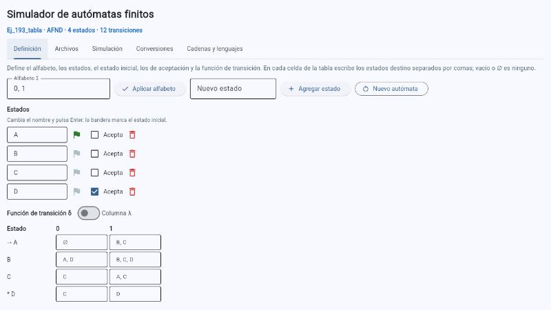
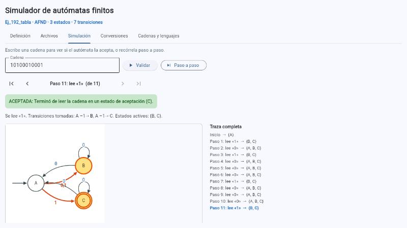
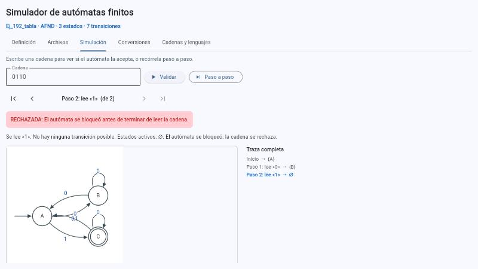
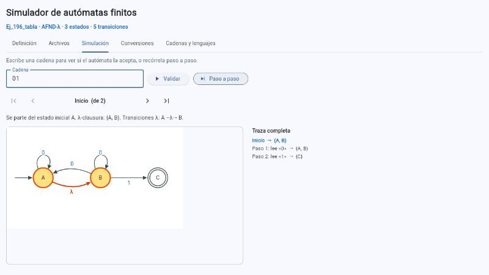
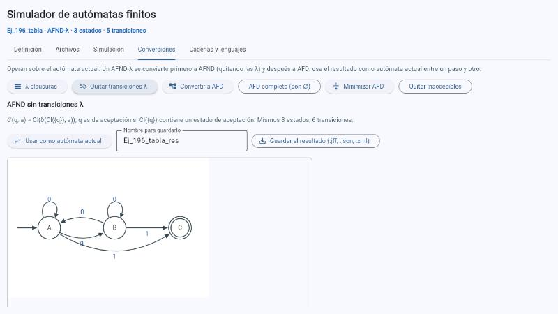
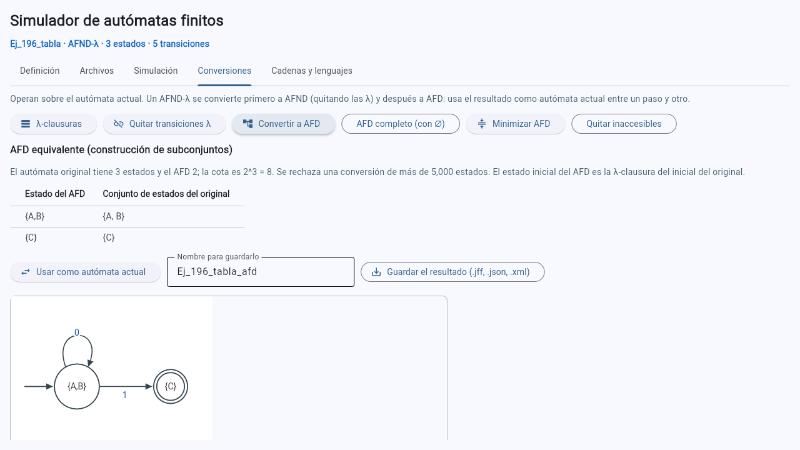
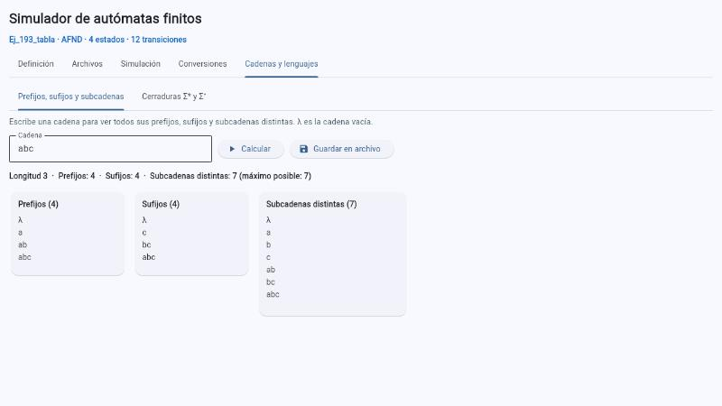

# Ejercicio 3. Simulador de autómatas con interfaz gráfica

> **Borrador.** Lo que se afirma aquí se comprobó contra el código y las pruebas. Los recuadros **«Tu parte»** marcan lo que debes revisar o redactar con tus palabras. Borra estas indicaciones antes de entregar.

Aplicación en Python con [Flet](https://flet.dev) 0.86.5 (`src/app.py`) que define, importa, simula, convierte y exporta autómatas finitos (AFD, AFND y AFND-λ). Se ejecuta con `docker compose up py312` y se abre en <http://localhost:8550> (véase [01-entorno.md](01-entorno.md)).

## 3.0. Arquitectura: el núcleo no depende de Flet

El enunciado pide mantener la separación de la Práctica 1: la lógica del autómata y la lectura de los formatos no deben depender de Flet. **Solo `src/app.py` importa Flet** (y su prueba); todo lo demás se prueba sin abrir una ventana.

| Módulo | Qué contiene | ¿Usa Flet? |
|---|---|---|
| `src/lenguajes.py` | Operaciones sobre cadenas y lenguajes (Práctica 1) | No |
| `src/automata.py` | Quíntupla, λ-clausura, δ y δ̂, simulación, caminos de cómputo, quitar λ, subconjuntos, minimización, comparación de lenguajes | No |
| `src/formatos.py` | Lectura y escritura de `.jff`, `.json` y `.xml` | No |
| `src/construcciones.py` | Constructores de patrones (AFN de «contiene» y «termina en», AFD por KMP) | No |
| `src/dibujo.py` | Diagrama del autómata como imagen SVG | No |
| `src/controlador.py` | Lógica de la interfaz: editar alfabeto y transiciones, listar y guardar archivos, textos del recorrido | No |
| `src/ejercicios.py`, `src/expresiones.py` | Definición de los autómatas de la Lista 3; expresiones regulares | No |
| `src/app.py` | Arma la pantalla y llama a lo anterior; no calcula nada por su cuenta | **Sí** |

## 3.1. Definición interactiva del autómata

La pestaña **Definición** permite:

- **Alfabeto**: se escribe como `a, b` o `ab`; cada símbolo es un solo carácter visible y `λ` no puede ser símbolo (se reserva para la cadena vacía). Al quitar un símbolo se quitan también las transiciones que lo leían y se informa cuántas fueron.
- **Estados**: agregar, quitar (con sus transiciones) y **renombrar** (cambiar el texto y pulsar Enter); marcar el estado inicial (bandera) y los de aceptación (casilla).
- **Función de transición δ**: una **tabla interactiva** con una fila por estado y una columna por símbolo (y una columna λ opcional). En cada celda se escriben los estados destino separados por comas; vacío o `∅` es ninguno. Una celda con un estado que no existe se rechaza con su motivo y no deja el autómata a medias.
- **Edición y corrección**: todo lo anterior se puede cambiar en cualquier momento, y *Nuevo autómata* reinicia la definición.
- **Representación visual**: el diagrama (con zoom y arrastre) y la **tabla de transiciones completa**, con `→` en el inicial y `*` en los de aceptación. El tipo (AFD, AFND o AFND-λ) se deduce de las transiciones y se muestra arriba, junto a los estados y las transiciones.

*Figura 1. Pestaña Definición con el AFN del ejercicio 193 cargado: alfabeto, estados con su bandera y casilla, y la tabla de transiciones editable.*

## 3.2. Importación desde archivos

La pestaña **Archivos** carga `.jff` (formato nativo de JFLAP), `.json` y `.xml`, eligiendo de una lista de los archivos de `automatas/` y `salidas/` o escribiendo una ruta. La lectura verifica los **cinco componentes de la quíntupla**:

| Componente | `.jff` | `.json` | `.xml` |
|---|---|---|---|
| Alfabeto Σ | Se **deduce** de los símbolos de las transiciones (el `.jff` no lo guarda) | `"alfabeto"` | `<alfabeto>` con un `<simbolo>` cada uno |
| Estados Q | `<state id name>` | `"estados"` | `<estado nombre>` |
| Estado inicial q₀ | `<initial/>` | `"inicial"` (o `null`) | `inicial="true"` |
| Estados de aceptación F | `<final/>` | `"aceptacion"` | `aceptacion="true"` |
| Función de transición δ | `<transition>` con `<from>`, `<to>`, `<read>` | `"transiciones"`: `desde`, `lee`, `hacia` (lista) | `<transicion desde lee hacia>` |

**Convención para λ**: la transición λ se escribe con la **cadena vacía como símbolo leído** en los tres formatos (`<read/>`, `"lee": ""`, `lee=""`). Al leer también se acepta el carácter `λ`, que no puede ser símbolo del alfabeto, así que no hay ambigüedad. Las coordenadas `x` e `y` del `.jff` solo sirven para dibujar: se leen y se conservan, pero no influyen en el alfabeto ni en δ. Un símbolo del alfabeto que ninguna transición lee se pierde en el `.jff`; la aplicación avisa de ello al guardar.

Un archivo incorrecto se rechaza con un mensaje claro (32 casos probados: estado inexistente, dos estados iniciales, tipo contradictorio, símbolo de varios caracteres, etc.). Además, la lectura rechaza XML con declaraciones `DOCTYPE` o `ENTITY` y archivos de más de 5 MB.

## 3.3. Simulación y validación de cadenas

La pestaña **Simulación** valida una cadena (resultado y traza completa) o la recorre **paso a paso**: en cada paso muestra el símbolo leído, las transiciones tomadas (incluidas las λ), los estados activos y el diagrama con los estados activos en amarillo y las transiciones del paso en rojo. La cadena vacía se escribe vacía o `λ`. Un símbolo fuera del alfabeto se rechaza con su mensaje. Para los no deterministas, un botón lista los **caminos de cómputo**, con las ramas que se bloquean.

*Figura 2. El AFN del ejercicio 192 acepta `10100010001`: al terminar quedan activos {B, C} y C es de aceptación. A la derecha, la traza completa.*

*Figura 3. El mismo AFN con `0110`: tras leer `01` no queda ningún estado activo, el autómata se bloquea y rechaza.*

*Figura 4. Paso inicial del AFND-λ del ejercicio 196 con `01`: la λ-clausura de A es {A, B} y se resalta la transición λ.*

### Decisión de diseño para el no determinismo

El enunciado pide elegir entre **simular siguiendo todos los caminos posibles** o **convertir el autómata a un AFD equivalente y simular el resultado**. Se eligió **seguir todos los caminos a la vez**: se avanza con el conjunto de estados activos (con su λ-clausura) y no se construye el AFD. Ambas opciones están disponibles en la aplicación; la conversión es una operación aparte (pestaña *Conversiones*), porque las listas la piden.

**Razones.** (1) Usa memoria proporcional a |Q| y no puede «explotar»: la conversión puede crear hasta 2^|Q| estados. (2) Muestra el no determinismo, que es lo que el ejercicio quiere ver: en cada paso se ven todos los estados activos y cuántos caminos hay. (3) Es el mismo algoritmo para AFD, AFND y AFND-λ. (4) No hay costo de preparación.

**Coste de cada alternativa.**

| | Seguir todos los caminos | Convertir a AFD y simular |
|---|---|---|
| Preparación | Ninguna | Construcción de subconjuntos: hasta 2^\|Q\| estados |
| Tiempo por cadena `w` | O(\|w\|·\|δ\|) en el peor caso | O(\|w\|) |
| Memoria | O(\|Q\|) | O(2^\|Q\|) en el peor caso |
| Se ve el no determinismo | Sí | No |

La aplicación limita la conversión a 5 000 estados (`LIMITE_ESTADOS_AFD`) y las cadenas a 1 000 símbolos. Medición con la familia «el n-ésimo símbolo desde el final es 1», en la que el AFD sí alcanza 2ⁿ estados (100 cadenas de 1 000 símbolos; Python 3.13 en Windows; los valores absolutos dependen de la computadora, lo que importa es la proporción):

### Medición del costo

| n | Estados AFN | Estados AFD | 2ⁿ | Construir el AFD (s) | 100 cadenas con el AFN (s) | Las mismas con el AFD (s) |
|---|---|---|---|---|---|---|
| 4 | 5 | 16 | 16 | 0,000 | 0,134 | 0,078 |
| 8 | 9 | 256 | 256 | 0,003 | 0,213 | 0,081 |
| 12 | 13 | 4 096 | 4 096 | 0,533 | 0,296 | 0,093 |

Reproducible con `python herramientas/medir_costos.py`. Seguir todos los caminos cuesta entre 1,7 y 3,2 veces más que recorrer el AFD ya construido, pero el AFD de n = 12 tiene 315 veces más estados que el AFN y tarda 0,5 s en construirse: solo compensa si se van a probar muchísimas cadenas con el mismo autómata y el AFD es pequeño. En los AFN de los ejercicios de la Lista 3 hay, en las cadenas de prueba, entre 1 y 4 estados activos en promedio, es decir, el costo de seguir todos los caminos es muy cercano al de un AFD.

> **Tu parte:** revisa si esta justificación te convence y reescríbela con tus palabras; es lo que el enunciado pide documentar. Si prefieres la otra opción, dímelo antes de entregar y se cambia.

## 3.4. Exportación y operaciones sobre lenguajes

- **Exportación**: *Guardar .jff*, *.json*, *.xml* o *los tres*, en la carpeta `salidas/` del proyecto, con el nombre que se escriba (se limpia para que no pueda salir de esa carpeta). También el **diagrama como `.svg`**.
- **Conversiones** (pestaña *Conversiones*): λ-clausuras, quitar transiciones λ, AFD por subconjuntos (con la cota 2ⁿ y la tabla de subconjuntos), AFD completo, minimización con las particiones y quitar estados inaccesibles. El resultado se puede usar como autómata actual (para encadenar AFND-λ → AFND → AFD) o guardar.
- **Operaciones de la Práctica 1** (pestaña *Cadenas y lenguajes*): subcadenas, prefijos, sufijos, cerradura de Kleene y cerradura positiva, con las mismas funciones de `src/lenguajes.py`.

*Figura 5. El AFND-λ del ejercicio 196 convertido a AFND sin transiciones λ.*

*Figura 6. Construcción de subconjuntos del ejercicio 196: tabla de estados del AFD y su diagrama.*

*Figura 7. Prefijos, sufijos y subcadenas de `abc`, integrados en la misma interfaz.*

## 3.5. Pruebas

La suite tiene **749 pruebas** (`pytest -q`), que se ejecutan en los tres contenedores y en la integración continua.

| Archivo | Pruebas | Qué cubre |
|---|---|---|
| `tests/test_lenguajes.py` | 63 | Operaciones de la Práctica 1 |
| `tests/test_automata.py` | 84 | Núcleo: aceptación, λ-clausura, δ̂, caminos, conversiones, minimización, cota 2ⁿ |
| `tests/test_formatos.py` | 207 | Los tres formatos y su lectura incorrecta |
| `tests/test_controlador.py` | 42 | Lógica de la interfaz y el dibujo |
| `tests/test_app.py` | 41 | Los manejadores de la pantalla, con una página simulada |
| `tests/test_lista2.py` | 69 | Cada autómata de la Lista 2 contra la definición exacta de su lenguaje |
| `tests/test_lista3.py` | 155 | Los autómatas de la Lista 3 y el verificador |
| `tests/test_expresiones.py` | 88 | Expresiones regulares |

Las pruebas que el enunciado pide como mínimo:

| Requisito del apartado 3.5 | Pruebas |
|---|---|
| Exportar e importar el mismo autómata en los tres formatos, **comprobando que son operaciones inversas** | `test_importar_lo_exportado_devuelve_el_mismo_automata` (10 autómatas × 3 formatos) y `test_pasar_por_los_tres_formatos_y_volver_no_cambia_nada`, en `test_formatos.py`; además `test_cada_jff_entregado_tiene_su_json_y_su_xml_con_el_mismo_automata` para cada archivo de `automatas/` |
| Aceptación y rechazo de cadenas en un AFD | `test_el_afd_acepta_las_cadenas_con_numero_par_de_ceros`, `test_el_afd_rechaza_las_cadenas_con_numero_impar_de_ceros` y `test_el_afd_coincide_con_la_definicion_en_todas_las_cadenas_hasta_longitud_10`, en `test_automata.py` |
| Aceptación en un AFND-λ cuyo reconocimiento requiere la λ-clausura | `test_la_cadena_vacia_se_acepta_solo_gracias_a_la_clausura` y `test_la_clausura_tambien_se_aplica_despues_de_leer_un_simbolo`, en `test_automata.py`: sin la transición λ la cadena vacía se rechaza |

Para comprobar los cinco componentes de la quíntupla hay `test_se_interpretan_los_cinco_componentes_de_la_quintupla`, que lee los tres archivos del Anexo 3 del enunciado y comprueba que dan el mismo autómata.

> **Tu parte:** las pruebas deben aprobarse en los tres contenedores y en la integración continua; las capturas están en [01-entorno.md](01-entorno.md#15-evidencias). Si alguna versión falla, corrígelo antes de entregar.

## Referencias

Appveyor Systems Inc. (2026). *flet* (Versión 0.86.5) [Paquete de Python]. Python Package Index. Recuperado el 5 de octubre de 2026, de https://pypi.org/project/flet/0.86.5/

Hopcroft, J. E., Motwani, R. y Ullman, J. D. (2007). *Teoría de autómatas, lenguajes y computación* (3.ª ed.). Pearson Educación. ISBN: *(cópialo de la página legal de tu ejemplar)*.

Rodger, S. H. y Finley, T. W. (2006). *JFLAP: An interactive formal languages and automata package*. Jones & Bartlett.
